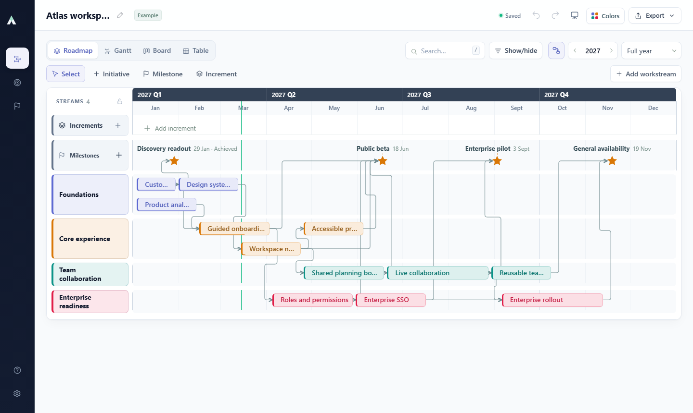

# Arc roadmap planner

A product roadmap planner in a single HTML file. Plan workstreams, initiatives, milestones and increments on a timeline, link them with dependencies, and export the result as a PDF.

**[Open the live demo →](https://martingrossman.github.io/Roadmap/)**



## Ways to use it

| | Where your data lives | Good for |
|---|---|---|
| **[Live demo](https://martingrossman.github.io/Roadmap/)** | Your browser only. Nobody else sees your changes. | Trying it out |
| **Download [`roadmap.html`](roadmap.html)** and open it | Your browser. **Export → HTML** saves a copy with the plan inside. | Working offline, sharing a snapshot |
| **[On Google Sheets](apps-script/README.md)** | A Google Sheet, shared with your team | Team planning, editing data in the Sheet |

## What it does

- **Views:** roadmap (swimlanes), Gantt, board and table
- **Planning:** workstreams, initiatives, milestones, increments and outcomes with metrics
- **Dependencies:** drag from an item's edge to another item; arrows route around labels
- **Timeline:** full year, a quarter, or a custom range of months (longer ranges scroll sideways)
- **Look:** colour templates, custom palettes and a configurable timeline colour
- **Export:** PDF (selected period or all dates) and standalone HTML
- **Presentation mode**, undo/redo, search and show/hide filters

## Repository layout

```
roadmap.html        The whole app: markup, styles and script in one file. Also served as the demo.
index.html          Sends the demo's root URL to roadmap.html.
apps-script/        Google Sheets version: build script, server code, generated bundle, test page.
docs/               Backlog and images.
```

## Development

Edit `roadmap.html` and open it in a browser; there is no build step for the standalone app. Every push to `master` updates the demo through GitHub Pages.

To update the Google Sheets version:

```sh
node apps-script/build.mjs        # regenerates apps-script/dist from roadmap.html
cd apps-script/dist
clasp push                        # upload to the Apps Script project
clasp deploy -i <deployment-id> -d "description"
```

See [`apps-script/README.md`](apps-script/README.md) for the first-time setup and [`docs/Backlog.md`](docs/Backlog.md) for planned work.

## License

[MIT](LICENSE)
