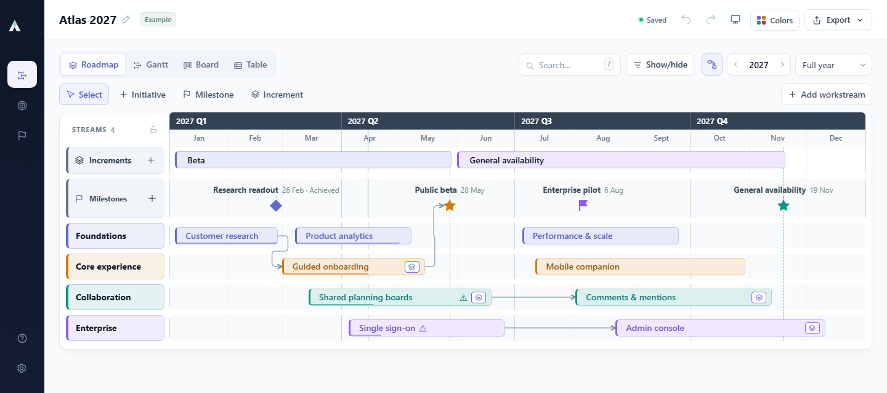

# Roadmap planner

A product roadmap planner in a single HTML file. Plan workstreams, initiatives, milestones and increments on a timeline, link them with dependencies, and export the result as a PDF.

**[Open the live demo →](https://martingrossman.github.io/Roadmap/)**



## Ways to use it

| | Where your data lives | Good for |
|---|---|---|
| **[Live demo](https://martingrossman.github.io/Roadmap/)** | Your browser only. Nobody else sees your changes. | Trying it out |
| **Download [`roadmap.html`](roadmap.html)** and open it | Your browser. **Export → HTML** saves a copy with the plan inside. | Working offline, sharing a snapshot |
| **[On Google Sheets](apps-script/README.md)** | A Google Sheet, shared with your team | Team planning, editing data in the Sheet |

## Google Sheets in short

The Sheet holds the data, one tab per kind of item. Everything starts from the **🗺️ Roadmap** menu in the Sheet's menu bar:

| Menu item | What it does |
|---|---|
| **🚀 Open planner** | Opens the planner in a large window on top of the Sheet. Needs no deployment, so it works in any copy. |
| **↗️ Open in new tab** | Opens the planner in its own browser tab through the web app. Gives you a link you can send. |
| **🔗 Set planner link…** | Saves or changes the web app link that **Open in new tab** uses. |
| **📥 Load example plan…** | Choose one of seven ready-made roadmaps (including the live demo plan). Replaces the Sheet's data. |
| **🎨 Reapply tab formatting** | Restores headers, dropdowns and colours on the tabs. |

**Sharing a Sheet so others get their own planner:**

1. Share the Sheet (view access is enough for copying).
2. They choose **File → Make a copy**.
3. In their copy they choose **🗺️ Roadmap → 🚀 Open planner** and approve the script once. The planner works with the copy's own data.
4. Optional: for the planner in its own tab, they choose **↗️ Open in new tab**. Google doesn't copy web app deployments, so the menu walks them through deploying their own (about a minute).

A copy never opens or saves to the original Sheet: the original's web app link and Sheet id are tagged with its script id, and a copy has a different one.

**Things to know:**

- Viewers can't run a Sheet's menu. Send them the web app link instead, and they see the plan read-only.
- Google keeps a margin around the window on top of the Sheet, so **🚀 Open planner** scales the planner down a little (never below 70%) to fit a full year. **↗️ Open in new tab** shows it at full size.
- PDF export may be blocked inside the window on top of the Sheet. If it is, use **↗️ Open in new tab** to export.

Full setup, permissions and limits: [`apps-script/README.md`](apps-script/README.md).

## What it does

- **Views:** roadmap (swimlanes), Gantt, board and table
- **Planning:** workstreams, initiatives, milestones, increments and outcomes with metrics. Drag Initiative, Milestone or Increment from the toolbar onto the roadmap or Gantt to create one at that date and workstream
- **Custom icons:** give any workstream, initiative, milestone or increment its own small image. Select the item and paste (Ctrl+V), or use **Choose image…** in its details. Icons show on screen and in the PDF, and are kept in the Sheet
- **Workstreams hold any mix:** a workstream can hold initiatives, milestones and increments, or only some of them. Milestones and increments without a workstream stay in the plan-wide rows at the top
- **Epics, stories and checklists:** split an initiative into stories (points, owner, status and a checklist); initiatives can have a checklist too. An initiative's progress rolls up from its stories' points, otherwise from its checklist. Plan settings → *Call the dated items* names them Initiatives, Epics or Features
- **Backlog:** unplanned stories on the left and one column per increment, with planned points against the increment's capacity; drag a story to plan it. The board can also show stories by status
- **Dependencies:** drag from an item's edge to another item; arrows route around labels. Every prerequisite is stored once (the Connections list), so arrows, warnings and milestone readiness always agree
- **Timeline:** opens around today (2 months back, 10 ahead) and scrolls sideways through time; **Today** (or the T key) jumps back, the arrows move earlier or later, and the months on screen show between them. A scroll stays on the axis it started on, so the timeline does not drift sideways while scrolling down (Shift + wheel scrolls sideways). Full year, a quarter or a custom range are still available
- **Zoom:** − and + (or a trackpad or touch pinch) change how much fits on screen: about 3½ years, 12 months, 13 weeks or 3 weeks. **Fit** (or the F key) zooms to show every item at once
- **Look:** colour templates, custom palettes and a configurable timeline colour
- **Export and import:** PDF (selected period or all dates), standalone HTML, a JSON backup, an **Excel workbook** of the whole roadmap, and the initiatives as CSV (with ids, so importing the same file again never re-links by name). The workbook has one tab per type (Settings, Workstreams, Initiatives, Stories, Outcomes, Milestones, Increments, Connections), the same tabs and columns as the Google Sheet version; importing it back replaces the plan exactly. **Import from spreadsheet** also reads a simple CSV or Excel list of initiatives and milestones: rows matching an existing initiative (same name and workstream) update it, new ones are added, and unknown workstreams are created. Every import shows what will change and can be undone
- **Examples:** Plan settings → **Load example** offers seven ready-made roadmaps, from simple to every option: *Very simple* (initiatives only), *Simple with milestones*, *Milestones in workstreams*, *Outcomes & dependencies* (metrics, health and a date conflict), *Epics, stories & sprints* (stories with points and checklists in two-week sprints, see the Backlog), *Release train* (teams with their own increments and milestones) and *Advanced* (everything together, the live demo)
- **Presentation mode**, undo/redo, search and show/hide filters; Show/hide can hide all increments or only the plan-wide Increments row, and all milestones or only the plan-wide Milestones row

## Repository layout

```
roadmap.html        The whole app: markup, styles and script in one file. Also served as the demo.
index.html          Sends the demo's root URL to roadmap.html.
apps-script/        Google Sheets version: build script, server code, generated bundle, test page.
docs/               Backlog and images.
```

## Development

Edit `roadmap.html` and open it in a browser; there is no build step for the standalone app. Every push to `master` updates the demo through GitHub Pages.

To update the Google Sheets version:

```powershell
node apps-script/deploy.mjs -d "What changed"
```

This rebuilds `apps-script/dist` from `roadmap.html`, uploads it with clasp, redeploys the existing web app (the link stays the same) and gives the Sheet's menu that link. It needs clasp set up once, as described in the Sheets guide. To only rebuild, run `node apps-script/build.mjs`.

See [`apps-script/README.md`](apps-script/README.md) for the first-time setup and [`docs/Backlog.md`](docs/Backlog.md) for planned work.

## License

[MIT](LICENSE)
